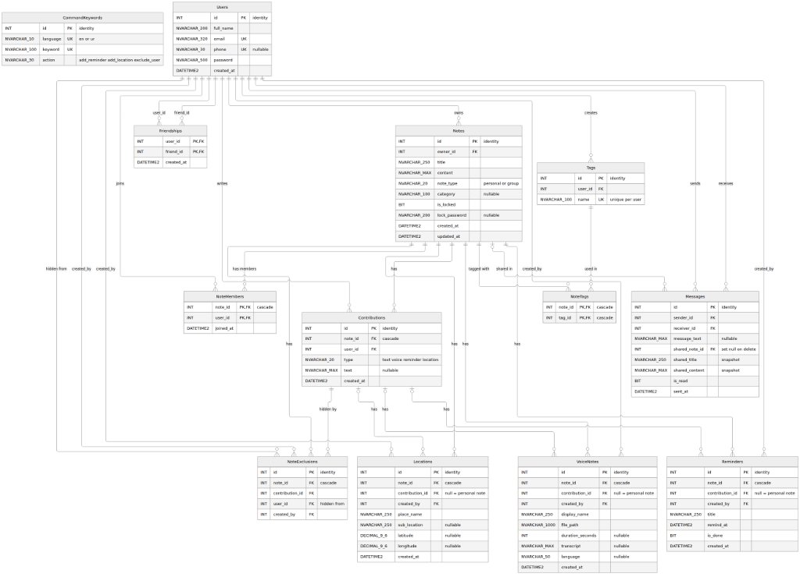
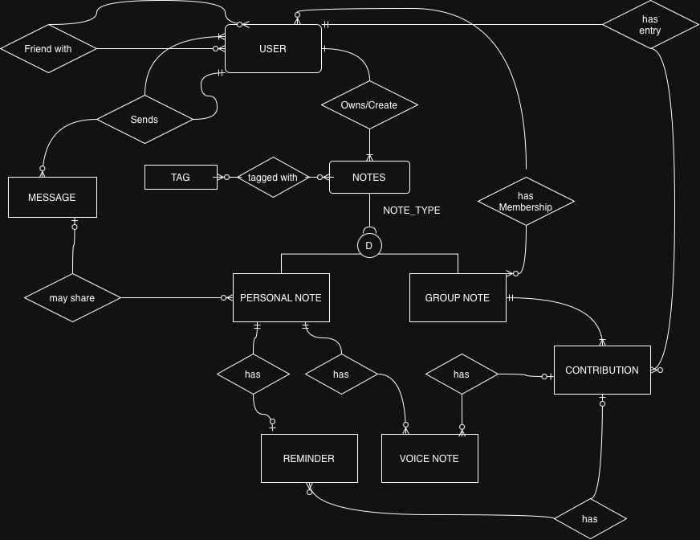

# SmartNotesApp_Backend_v2

Backend API for **Smart Notes** built with .NET (ASP.NET Core), Entity Framework Core, SQL Server, and offline Whisper AI transcription for multilingual voice notes (English & Urdu).

---

## Table of Contents
1. [How to Clone](#how-to-clone)
2. [Database Connection Configuration](#database-connection-configuration)
3. [Database Creation & Setup in SSMS](#database-creation--setup-in-ssms)
   - [Schema Script](#1-schema-script)
   - [Demo Data Script](#2-demo-data-script)
4. [Database Relational Schema](#database-relational-schema)
5. [Entity Relationship Diagram (ERD)](#entity-relationship-diagram-erd)
6. [How to Run the Application](#how-to-run-the-application)
7. [Demo Accounts](#demo-accounts)

---

## How to Clone

> **Important**: This repository tracks the offline Whisper AI speech-to-text model (`models/ggml-small-ur-en.bin`, ~487 MB) via **Git LFS**.
> 
> The voice model is automatically retrieved through LFS directly into the `models/` directory during clone—no manual model downloads or Python conversions are needed by teammates.
> 
> 1. **Install Git LFS first** (`brew install git-lfs` on macOS, or from [git-lfs.com](https://git-lfs.com/) on Windows/Linux).
> 2. Run `git lfs install` once to initialize the hooks.
> 3. Then run `git clone`:

```bash
# 1. Ensure Git LFS is installed and initialized
git lfs install

# 2. Clone the repository (downloads code + models/ggml-small-ur-en.bin)
git clone https://github.com/M-S-A-K/SmartNotesApp_Backend_v2.git
cd SmartNotesApp_Backend_v2

# (Optional) If the model file in models/ appears as a tiny ~130-byte pointer, pull it:
git lfs pull
```

---

## Database Connection Configuration

You can configure your database connection string in either `appsettings.json` or as a local development override in `appsettings.Development.json` (recommended so you don't commit personal passwords).

### Setting the Connection String in `appsettings.Development.json`:

Create or edit `appsettings.Development.json` in the project root:

```json
{
  "ConnectionStrings": {
    "SmartNotesDb": "Server=localhost,1433;Database=SmartNotesV1;User Id=sa;Password=your_password_here;TrustServerCertificate=True;"
  },
  "Logging": {
    "LogLevel": {
      "Default": "Information",
      "Microsoft.AspNetCore": "Warning"
    }
  }
}
```

Or configure it in `appsettings.json`:

```json
{
  "ConnectionStrings": {
    "SmartNotesDb": "Server=localhost,1433;Database=SmartNotesV1;User Id=sa;Password=your_password_here;TrustServerCertificate=True;"
  },
  "Logging": {
    "LogLevel": {
      "Default": "Information",
      "Microsoft.AspNetCore": "Warning"
    }
  },
  "AllowedHosts": "*"
}
```

### Connection String Parameters:
- **Server**: Your SQL Server instance name or address.
  - Standard / Docker: `localhost,1433` or `127.0.0.1,1433`
  - SQL Express: `localhost\\SQLEXPRESS` or `.\\SQLEXPRESS`
  - LocalDB: `(localdb)\\MSSQLLocalDB`
- **Database**: Name of the database (by default, the schema script creates `SmartNotesV1`). Ensure this matches the database created in SQL Server.
- **Authentication**:
  - **SQL Server Authentication**: `User Id=sa;Password=your_password;`
  - **Windows Authentication**: `Trusted_Connection=True;` or `Integrated Security=True;`
- **TrustServerCertificate**: Set to `True` for local development.

---

## Database Creation & Setup in SSMS

To create and populate the database:
1. Open **SQL Server Management Studio (SSMS)** (or Rider / Azure Data Studio).
2. Connect to your SQL Server instance.
3. Open a **New Query** window.
4. Copy and execute the **Schema Script** below (or run [`Database/schema.sql`](Database/schema.sql)).
5. Open another query window (or execute in order) and run the **Demo Data Script** below (or run [`Database/demo_data.sql`](Database/demo_data.sql)).

### 1. Schema Script

```sql
/* Smart Notes V1 schema. Run the whole file in Rider (Query Console on the SQL Server connection) or SSMS.
   WARNING: it drops and recreates the SmartNotesV1 database, so all V1 data is wiped on every run.
   Delete rules: deleting a note really deletes it and everything inside it (ON DELETE CASCADE).
   User foreign keys use NO ACTION because V1 has no "delete account" feature. */

IF DB_ID(N'SmartNotesV1') IS NOT NULL
BEGIN
    ALTER DATABASE SmartNotesV1 SET SINGLE_USER WITH ROLLBACK IMMEDIATE;
    DROP DATABASE SmartNotesV1;
END;
GO
CREATE DATABASE SmartNotesV1;
GO
USE SmartNotesV1;
GO

/* ---------- Users and friends ---------- */

CREATE TABLE Users
(
    id INT IDENTITY(1,1) PRIMARY KEY,
    full_name NVARCHAR(200) NOT NULL,
    email NVARCHAR(320) NOT NULL UNIQUE,
    phone NVARCHAR(30) NULL,
    password NVARCHAR(500) NOT NULL,          -- plain text for now (wide enough to hash later)
    created_at DATETIME2 NOT NULL DEFAULT SYSUTCDATETIME()
);
GO
CREATE UNIQUE INDEX UX_Users_phone ON Users(phone) WHERE phone IS NOT NULL;
GO

-- Friends are added instantly. Each friendship is stored twice (A->B and B->A).
CREATE TABLE Friendships
(
    user_id INT NOT NULL,
    friend_id INT NOT NULL,
    created_at DATETIME2 NOT NULL DEFAULT SYSUTCDATETIME(),
    PRIMARY KEY (user_id, friend_id),
    CHECK (user_id <> friend_id),
    FOREIGN KEY (user_id) REFERENCES Users(id),
    FOREIGN KEY (friend_id) REFERENCES Users(id)
);
GO

/* ---------- Notes (personal or group) ---------- */

CREATE TABLE Notes
(
    id INT IDENTITY(1,1) PRIMARY KEY,
    owner_id INT NOT NULL,
    title NVARCHAR(250) NOT NULL,
    content NVARCHAR(MAX) NOT NULL DEFAULT N'',   -- personal note text (group notes use contributions)
    note_type NVARCHAR(20) NOT NULL CHECK (note_type IN (N'personal', N'group')),
    category NVARCHAR(100) NULL,
    is_locked BIT NOT NULL DEFAULT 0,
    lock_password NVARCHAR(200) NULL,             -- plain text
    created_at DATETIME2 NOT NULL DEFAULT SYSUTCDATETIME(),
    updated_at DATETIME2 NOT NULL DEFAULT SYSUTCDATETIME(),
    FOREIGN KEY (owner_id) REFERENCES Users(id)
);
GO
CREATE INDEX IX_Notes_owner ON Notes(owner_id);
GO

CREATE TABLE Tags
(
    id INT IDENTITY(1,1) PRIMARY KEY,
    user_id INT NOT NULL,
    name NVARCHAR(100) NOT NULL,
    UNIQUE (user_id, name),
    FOREIGN KEY (user_id) REFERENCES Users(id)
);
GO

CREATE TABLE NoteTags
(
    note_id INT NOT NULL,
    tag_id INT NOT NULL,
    PRIMARY KEY (note_id, tag_id),
    FOREIGN KEY (note_id) REFERENCES Notes(id) ON DELETE CASCADE,
    FOREIGN KEY (tag_id) REFERENCES Tags(id) ON DELETE CASCADE
);
GO

/* ---------- Group notes: members and contributions ---------- */

-- Group notes only. The owner also gets a row here. Leaving a group = delete your row.
CREATE TABLE NoteMembers
(
    note_id INT NOT NULL,
    user_id INT NOT NULL,
    joined_at DATETIME2 NOT NULL DEFAULT SYSUTCDATETIME(),
    PRIMARY KEY (note_id, user_id),
    FOREIGN KEY (note_id) REFERENCES Notes(id) ON DELETE CASCADE,
    FOREIGN KEY (user_id) REFERENCES Users(id)
);
GO
CREATE INDEX IX_NoteMembers_user ON NoteMembers(user_id);
GO

-- One item added to a group note by a member. Own contributions only can be edited or deleted.
CREATE TABLE Contributions
(
    id INT IDENTITY(1,1) PRIMARY KEY,
    note_id INT NOT NULL,
    user_id INT NOT NULL,
    type NVARCHAR(20) NOT NULL CHECK (type IN (N'text', N'voice', N'reminder', N'location')),
    text NVARCHAR(MAX) NULL,
    created_at DATETIME2 NOT NULL DEFAULT SYSUTCDATETIME(),
    UNIQUE (note_id, id),
    FOREIGN KEY (note_id) REFERENCES Notes(id) ON DELETE CASCADE,
    FOREIGN KEY (user_id) REFERENCES Users(id)
);
GO

-- Hides one contribution from one member (voice command "don't share with X").
CREATE TABLE NoteExclusions
(
    id INT IDENTITY(1,1) PRIMARY KEY,
    note_id INT NOT NULL,
    contribution_id INT NOT NULL,
    user_id INT NOT NULL,                          -- the member who must not see it
    created_by INT NOT NULL,
    UNIQUE (contribution_id, user_id),
    FOREIGN KEY (note_id) REFERENCES Notes(id) ON DELETE CASCADE,
    FOREIGN KEY (note_id, contribution_id) REFERENCES Contributions(note_id, id),
    FOREIGN KEY (user_id) REFERENCES Users(id),
    FOREIGN KEY (created_by) REFERENCES Users(id)
);
GO

/* ---------- Reminders, locations, voice notes ----------
   Personal note item: contribution_id is NULL. Group note item: contribution_id is set.
   Deleting the note deletes them all. Deleting ONE contribution: the service deletes its
   reminder/location/voice rows first, then the contribution. */

CREATE TABLE Reminders
(
    id INT IDENTITY(1,1) PRIMARY KEY,
    note_id INT NOT NULL,
    contribution_id INT NULL,
    created_by INT NOT NULL,
    title NVARCHAR(250) NOT NULL,
    remind_at DATETIME2 NOT NULL,
    is_done BIT NOT NULL DEFAULT 0,
    created_at DATETIME2 NOT NULL DEFAULT SYSUTCDATETIME(),
    FOREIGN KEY (note_id) REFERENCES Notes(id) ON DELETE CASCADE,
    FOREIGN KEY (note_id, contribution_id) REFERENCES Contributions(note_id, id),
    FOREIGN KEY (created_by) REFERENCES Users(id)
);
GO
CREATE INDEX IX_Reminders_remind_at ON Reminders(remind_at);
CREATE UNIQUE INDEX UX_Reminders_one_per_personal_note ON Reminders(note_id) WHERE contribution_id IS NULL;
GO

CREATE TABLE Locations
(
    id INT IDENTITY(1,1) PRIMARY KEY,
    note_id INT NOT NULL,
    contribution_id INT NULL,
    created_by INT NOT NULL,
    place_name NVARCHAR(250) NOT NULL,
    sub_location NVARCHAR(250) NULL,
    latitude DECIMAL(9,6) NULL,
    longitude DECIMAL(9,6) NULL,
    created_at DATETIME2 NOT NULL DEFAULT SYSUTCDATETIME(),
    CHECK (latitude IS NULL OR latitude BETWEEN -90 AND 90),
    CHECK (longitude IS NULL OR longitude BETWEEN -180 AND 180),
    CHECK ((latitude IS NULL AND longitude IS NULL) OR (latitude IS NOT NULL AND longitude IS NOT NULL)),
    FOREIGN KEY (note_id) REFERENCES Notes(id) ON DELETE CASCADE,
    FOREIGN KEY (note_id, contribution_id) REFERENCES Contributions(note_id, id),
    FOREIGN KEY (created_by) REFERENCES Users(id)
);
GO
CREATE UNIQUE INDEX UX_Locations_one_per_personal_note ON Locations(note_id) WHERE contribution_id IS NULL;
GO

CREATE TABLE VoiceNotes
(
    id INT IDENTITY(1,1) PRIMARY KEY,
    note_id INT NOT NULL,
    contribution_id INT NULL,
    created_by INT NOT NULL,
    display_name NVARCHAR(250) NOT NULL,
    file_path NVARCHAR(1000) NOT NULL,             -- file stays on disk, DB keeps the path
    duration_seconds INT NULL,
    transcript NVARCHAR(MAX) NULL,
    language NVARCHAR(50) NULL,
    created_at DATETIME2 NOT NULL DEFAULT SYSUTCDATETIME(),
    FOREIGN KEY (note_id) REFERENCES Notes(id) ON DELETE CASCADE,
    FOREIGN KEY (note_id, contribution_id) REFERENCES Contributions(note_id, id),
    FOREIGN KEY (created_by) REFERENCES Users(id)
);
GO

/* ---------- Messages (1:1 chat, can share a personal note) ----------
   Sharing copies the note's title and content into the message (a snapshot),
   so the message still shows it after the owner deletes the note from his library. */

CREATE TABLE Messages
(
    id INT IDENTITY(1,1) PRIMARY KEY,
    sender_id INT NOT NULL,
    receiver_id INT NOT NULL,
    message_text NVARCHAR(MAX) NULL,
    shared_note_id INT NULL,                       -- becomes NULL if the note is deleted
    shared_title NVARCHAR(250) NULL,               -- snapshot
    shared_content NVARCHAR(MAX) NULL,             -- snapshot
    is_read BIT NOT NULL DEFAULT 0,
    sent_at DATETIME2 NOT NULL DEFAULT SYSUTCDATETIME(),
    CHECK (sender_id <> receiver_id),
    CHECK (NULLIF(LTRIM(RTRIM(message_text)), N'') IS NOT NULL OR shared_title IS NOT NULL),
    FOREIGN KEY (sender_id) REFERENCES Users(id),
    FOREIGN KEY (receiver_id) REFERENCES Users(id),
    FOREIGN KEY (shared_note_id) REFERENCES Notes(id) ON DELETE SET NULL
);
GO
CREATE INDEX IX_Messages_pair ON Messages(sender_id, receiver_id);
GO

/* ---------- Voice commands (English and Urdu) ---------- */

CREATE TABLE CommandKeywords
(
    id INT IDENTITY(1,1) PRIMARY KEY,
    language NVARCHAR(10) NOT NULL CHECK (language IN (N'en', N'ur')),
    keyword NVARCHAR(100) NOT NULL,
    action NVARCHAR(30) NOT NULL CHECK (action IN (N'add_reminder', N'add_location', N'exclude_user')),
    UNIQUE (language, keyword)
);
GO

INSERT INTO CommandKeywords (language, keyword, action) VALUES
 (N'en', N'remind me',        N'add_reminder'),
 (N'en', N'set a reminder',   N'add_reminder'),
 (N'en', N'reminder',         N'add_reminder'),
 (N'en', N'remind',           N'add_reminder'),
 (N'ur', N'یاد دلاؤ',         N'add_reminder'),
 (N'ur', N'یاد دہانی',        N'add_reminder'),
 (N'en', N'add location',     N'add_location'),
 (N'en', N'location',         N'add_location'),
 (N'en', N'place',            N'add_location'),
 (N'ur', N'مقام',             N'add_location'),
 (N'ur', N'جگہ',              N'add_location'),
 (N'en', N'don''t share',     N'exclude_user'),
 (N'en', N'do not share',     N'exclude_user'),
 (N'en', N'don''t send',      N'exclude_user'),
 (N'ur', N'مت بھیجو',         N'exclude_user'),
 (N'ur', N'مت دکھاؤ',         N'exclude_user');
GO
```

---

### 2. Demo Data Script

```sql
/* Smart Notes V1 demo data (Pakistani names, places and notes).
   Run this ONCE, right after schema.sql (it expects an empty SmartNotesV1 database).
   Every user's password is the first name in lowercase + 1234, in plain text. Example: usman / usman1234.
   The locked note's password is lock1234. */

USE SmartNotesV1;
GO

DECLARE @today DATETIME2 = CAST(CAST(SYSUTCDATETIME() AS DATE) AS DATETIME2);

/* ---------- Users ---------- */
SET IDENTITY_INSERT Users ON;
INSERT INTO Users (id, full_name, email, phone, password) VALUES
 (1,  N'Usman Ahmed',      N'usman@smartnotes.pk',  N'0300-1234567', N'usman1234'),
 (2,  N'Ali Raza',         N'ali@smartnotes.pk',    N'0301-2345678', N'ali1234'),
 (3,  N'Ayesha Khan',      N'ayesha@smartnotes.pk', N'0302-3456789', N'ayesha1234'),
 (4,  N'Fatima Noor',      N'fatima@smartnotes.pk', N'0303-4567890', N'fatima1234'),
 (5,  N'Hamza Malik',      N'hamza@smartnotes.pk',  N'0304-5678901', N'hamza1234'),
 (6,  N'Zainab Iqbal',     N'zainab@smartnotes.pk', N'0305-6789012', N'zainab1234'),
 (7,  N'Bilal Hussain',    N'bilal@smartnotes.pk',  N'0306-7890123', N'bilal1234'),
 (8,  N'Sara Yousaf',      N'sara@smartnotes.pk',   N'0307-8901234', N'sara1234'),
 (9,  N'Hassan Tariq',     N'hassan@smartnotes.pk', N'0308-9012345', N'hassan1234'),
 (10, N'Maryam Siddiqui',  N'maryam@smartnotes.pk', N'0309-0123456', N'maryam1234');
SET IDENTITY_INSERT Users OFF;

/* ---------- Friends (14 pairs, stored in both directions) ---------- */
DECLARE @pairs TABLE (a INT, b INT);
INSERT INTO @pairs (a, b) VALUES
 (1,2),(1,3),(1,5),(1,7),(2,5),(2,7),(3,4),(3,6),(4,8),(4,10),(5,9),(7,9),(6,10),(8,10);
INSERT INTO Friendships (user_id, friend_id) SELECT a, b FROM @pairs;
INSERT INTO Friendships (user_id, friend_id) SELECT b, a FROM @pairs;

/* ---------- Tags ---------- */
SET IDENTITY_INSERT Tags ON;
INSERT INTO Tags (id, user_id, name) VALUES
 (1, 1, N'University'), (2, 1, N'Urgent'), (3, 1, N'FYP'), (4, 1, N'Personal'),
 (5, 2, N'Sports'),     (6, 2, N'Travel'), (7, 2, N'Health'),
 (8, 3, N'Study'),      (9, 3, N'Urdu'),
 (10, 4, N'Shopping'),  (11, 5, N'Cricket');
SET IDENTITY_INSERT Tags OFF;

/* ---------- Notes: 1-7 personal, 8-10 group ---------- */
SET IDENTITY_INSERT Notes ON;
INSERT INTO Notes (id, owner_id, title, content, note_type, category, is_locked, lock_password) VALUES
 (1, 1, N'Database Systems assignment deadline',
     N'Complete SQL queries for normalization, indexing and joins by Thursday evening.',
     N'personal', N'Study', 0, NULL),
 (2, 1, N'Grocery list for weekend',
     N'Eggs, milk, brown bread, green tea, chicken and fresh vegetables from Commercial Market.',
     N'personal', N'Home', 0, NULL),
 (3, 2, N'Doctor appointment',
     N'Follow-up visit with Dr. Tariq at Shifa International Hospital. Bring the latest lab reports.',
     N'personal', N'Health', 0, NULL),
 (4, 2, N'Gym routine',
     N'Monday: chest and triceps. Wednesday: back and biceps. Friday: legs and shoulders. 20 minutes cardio every day.',
     N'personal', N'Fitness', 0, NULL),
 (5, 3, N'اردو ادب کے اہم نوٹس',
     N'علامہ اقبال کی شاعری میں خودی کا فلسفہ اور فیض احمد فیض کی نظموں کا تقابلی جائزہ تیار کرنا ہے۔',
     N'personal', N'Literature', 0, NULL),
 (6, 5, N'Gari ki servicing aur oil change',
     N'Saturday ko Saddar Rawalpindi workshop jana hai. Engine oil, air filter aur brake pads check karwane hain.',
     N'personal', N'Maintenance', 0, NULL),
 (7, 4, N'Locker details',
     N'Bank locker number 42, branch code 012. Annual fee is due next week.',
     N'personal', N'Finance', 1, N'lock1234'),
 (8, 1, N'FYP meeting notes',
     N'Final year project discussions: backend, database, voice notes and mobile screens.',
     N'group', N'Projects', 0, NULL),
 (9, 2, N'Murree trip plan',
     N'Weekend trip: leave on Friday morning, stay near Mall Road, Patriata chairlift on Saturday.',
     N'group', N'Travel', 0, NULL),
 (10, 5, N'Cricket match Sunday',
     N'Friendly tape-ball match against BIIT alumni. Match starts at 8:00 AM sharp.',
     N'group', N'Sports', 0, NULL);
SET IDENTITY_INSERT Notes OFF;

/* ---------- Tags on notes ---------- */
INSERT INTO NoteTags (note_id, tag_id) VALUES
 (1, 1), (1, 2), (2, 4), (3, 7), (4, 7), (5, 8), (5, 9), (8, 3), (8, 1), (9, 6), (10, 11);

/* ---------- Group members (the owner is a member too) ---------- */
INSERT INTO NoteMembers (note_id, user_id) VALUES
 (8, 1), (8, 2), (8, 3), (8, 5),
 (9, 2), (9, 1), (9, 7), (9, 9),
 (10, 5), (10, 2), (10, 7), (10, 1);

/* ---------- Contributions (items added to group notes) ---------- */
SET IDENTITY_INSERT Contributions ON;
INSERT INTO Contributions (id, note_id, user_id, type, text) VALUES
 -- FYP meeting notes
 (1,  8, 1, N'text', N'Sprint 1 targets agreed: finish the database tables and the login screens.'),
 (2,  8, 2, N'text', N'I will test the notes and reminders APIs in Scalar.'),
 (3,  8, 3, N'text', N'Flutter screens for login, signup and the notes list are drafted.'),
 (4,  8, 1, N'voice', NULL),
 (5,  8, 1, N'reminder', NULL),
 (6,  8, 2, N'location', NULL),
 -- Murree trip plan
 (7,  9, 2, N'text', N'Hotel booked near Mall Road, 2 rooms for 2 nights.'),
 (8,  9, 1, N'text', N'Bilal and I will manage petrol and motorway toll expenses.'),
 (9,  9, 2, N'voice', NULL),
 (10, 9, 2, N'location', NULL),
 (11, 9, 7, N'reminder', NULL),
 -- Cricket match Sunday
 (12, 10, 5, N'voice', NULL),
 (13, 10, 5, N'reminder', NULL),
 (14, 10, 5, N'location', NULL);
SET IDENTITY_INSERT Contributions OFF;

/* ---------- Reminders (personal notes: contribution_id is NULL) ---------- */
INSERT INTO Reminders (note_id, contribution_id, created_by, title, remind_at) VALUES
 (1, NULL, 1, N'Submit DB assignment',               DATEADD(HOUR,  9, DATEADD(DAY, 1, @today))),
 (2, NULL, 1, N'Buy weekend groceries',              DATEADD(HOUR, 11, DATEADD(DAY, 2, @today))),
 (3, NULL, 2, N'Doctor follow-up at Shifa Hospital', DATEADD(HOUR, 16, DATEADD(DAY, 3, @today))),
 (4, NULL, 2, N'Leg day workout',                    DATEADD(HOUR, 18, DATEADD(DAY, 1, @today))),
 (5, NULL, 3, N'اردو مقالہ مکمل کریں',               DATEADD(HOUR, 14, DATEADD(DAY, 4, @today))),
 (6, NULL, 5, N'Car oil change at Saddar',           DATEADD(HOUR, 10, DATEADD(DAY, 5, @today))),
 (7, NULL, 4, N'Pay locker annual fee',              DATEADD(HOUR, 10, DATEADD(DAY, 6, @today))),
 (8,  5, 1, N'Submit SRS document to supervisor',    DATEADD(HOUR, 15, DATEADD(DAY, 2, @today))),
 (9, 11, 7, N'Leave Islamabad for Murree by 6 AM',   DATEADD(HOUR,  6, DATEADD(DAY, 3, @today))),
 (10, 13, 5, N'Cricket ground warm-up at 7:30 AM',   DATEADD(MINUTE, 450, DATEADD(DAY, 4, @today)));

/* ---------- Locations ---------- */
INSERT INTO Locations (note_id, contribution_id, created_by, place_name, sub_location, latitude, longitude) VALUES
 (1, NULL, 1, N'Barani Institute of Information Technology', N'Computer Science Lab 3, Shamsabad',     33.649200, 73.081500),
 (2, NULL, 1, N'Commercial Market',                          N'Satellite Town, Rawalpindi',            33.642500, 73.072200),
 (3, NULL, 2, N'Shifa International Hospital',               N'Sector H-8/4, Islamabad',               33.676600, 73.082700),
 (4, NULL, 2, N'Centaurus Mall',                             N'Fitness gym, 4th floor, Islamabad',     33.707700, 73.050100),
 (6, NULL, 5, N'Saddar Auto Market',                         N'Babu Mohallah, Rawalpindi',             33.597200, 73.054300),
 (8,  6, 2, N'Faisal Mosque',                                N'Shah Faisal Avenue, Islamabad',         33.729700, 73.037200),
 (9, 10, 2, N'Mall Road Murree',                             N'Near GPO, Main Bazar, Murree',          33.907000, 73.394300),
 (10, 14, 5, N'Rawalpindi Cricket Stadium',                  N'Gate 3, Stadium Road',                  33.662800, 73.078900);

/* ---------- Voice notes (demo paths: the audio files do not exist on disk) ---------- */
INSERT INTO VoiceNotes (note_id, contribution_id, created_by, display_name, file_path, duration_seconds, transcript, language) VALUES
 (2, NULL, 1, N'Grocery voice note',  N'storage/voice/demo/grocery_urdu.wav',   8,  N'شام کو کمرشل مارکیٹ سے دودھ، انڈے اور سبزی لانی ہے۔', N'ur'),
 (4, NULL, 2, N'Gym voice note',      N'storage/voice/demo/gym_plan.wav',      12, N'Workout plan: Monday chest and triceps, Wednesday back and biceps.', N'en'),
 (8,  4, 1, N'FYP discussion',        N'storage/voice/demo/fyp_kickoff.wav',   25, N'Final year project discussion: voice transcription and the notes backend.', N'en'),
 (9,  9, 2, N'Murree hotel update',   N'storage/voice/demo/murree_hotel.wav',  15, N'Murree trip ke liye Mall Road ke paas hotel book ho chuka hai, sab warm kapray le aayen.', N'ur'),
 (10, 12, 5, N'Cricket line-up',      N'storage/voice/demo/cricket_lineup.wav', 14, N'Sunday cricket match Rawalpindi stadium mein subah aath baje shuru hoga.', N'ur');

/* ---------- Exclusions (a member must not see one contribution) ---------- */
INSERT INTO NoteExclusions (note_id, contribution_id, user_id, created_by) VALUES
 (8, 5, 5, 1),    -- Usman hides the SRS reminder from Hamza
 (9, 7, 9, 2);    -- Ali hides the hotel booking text from Hassan

/* ---------- Messages (a shared note is copied into the message) ---------- */
INSERT INTO Messages (sender_id, receiver_id, message_text, shared_note_id, shared_title, shared_content, is_read) VALUES
 (1, 2, N'Assalam-o-Alaikum Ali, FYP meeting ki details check kar lo.', NULL, NULL, NULL, 1),
 (2, 1, N'Walaikum Assalam Usman! Dekh liya hai, kal subah library mein milte hain.', NULL, NULL, NULL, 1),
 (1, 2, N'Database assignment ke notes share kar raha hoon.', 1,
        N'Database Systems assignment deadline',
        N'Complete SQL queries for normalization, indexing and joins by Thursday evening.', 1),
 (3, 4, N'Ayesha ne Urdu adab ke notes share kiye hain.', 5,
        N'اردو ادب کے اہم نوٹس',
        N'علامہ اقبال کی شاعری میں خودی کا فلسفہ اور فیض احمد فیض کی نظموں کا تقابلی جائزہ تیار کرنا ہے۔', 0),
 (2, 7, N'Bhai Murree trip ka plan final ho gaya hai?', NULL, NULL, NULL, 1),
 (7, 2, N'Haan, Friday subah 6 baje nikalna hai.', NULL, NULL, NULL, 1),
 (5, 1, N'Sunday cricket match ke liye kit ready hai?', NULL, NULL, NULL, 0),
 (4, 3, N'Shukriya Ayesha, notes se bohat madad mili.', NULL, NULL, NULL, 1),
 (5, 2, N'Rawalpindi stadium ki pitch report achi hai.', NULL, NULL, NULL, 1),
 (8, 4, N'Weekend par Centaurus shopping ke liye chalna hai?', NULL, NULL, NULL, 0),
 (9, 7, N'Murree trip ki photos group mein share karna.', NULL, NULL, NULL, 0),
 (6, 10, N'Exam schedule portal par laga diya gaya hai.', NULL, NULL, NULL, 1);
GO
```

---

## Database Relational Schema

Below is the physical relational schema diagram showing the tables, attributes, primary keys, and foreign key constraints:



### Tables Overview:
- **`Users`**: Stores user authentication credentials and contact details.
- **`Friendships`**: Bi-directional friend graph between users.
- **`Notes`**: Holds personal or group notes with titles, content, categories, and optional lock passwords.
- **`Tags`** & **`NoteTags`**: Many-to-many relationship linking custom tags to notes.
- **`NoteMembers`**: Membership records for group notes.
- **`Contributions`**: Atomic items added to group notes (text, voice, reminder, location).
- **`NoteExclusions`**: Granular visibility permissions hiding specific contributions from specific group members.
- **`Reminders`**: Date/time scheduled alerts associated with personal notes or group contributions.
- **`Locations`**: Geographic coordinates and place names for personal notes or group contributions.
- **`VoiceNotes`**: Audio metadata, disk file paths, language tags, and offline Whisper AI transcripts.
- **`Messages`**: 1-to-1 direct messaging with support for sharing snapshot copies of personal notes.
- **`CommandKeywords`**: Pre-configured voice command trigger keywords in English and Urdu.

---

## Entity Relationship Diagram (ERD)

Below is the conceptual Entity Relationship Diagram (ERD) detailing entities, cardinalities, and relationship mappings:



---

## How to Run the Application

### Prerequisites:
- [.NET 10 SDK](https://dotnet.microsoft.com/download) (or your configured target framework version)
- Microsoft SQL Server (running locally or in Docker)
- *Optional (for audio transcription)*: `afconvert` on macOS (built-in) or `ffmpeg` on Linux/Windows.

### Run via Command Line:
```bash
# 1. Restore packages
dotnet restore

# 2. Build the project
dotnet build

# 3. Run the API
dotnet run
```

---

## Demo Accounts

All demo accounts use the user's first name in lowercase + `1234`:

| Name | Email | Password |
| :--- | :--- | :--- |
| Usman Ahmed | `usman@smartnotes.pk` | `usman1234` |
| Ali Raza | `ali@smartnotes.pk` | `ali1234` |
| Ayesha Khan | `ayesha@smartnotes.pk` | `ayesha1234` |
| Fatima Noor | `fatima@smartnotes.pk` | `fatima1234` |
| Hamza Malik | `hamza@smartnotes.pk` | `hamza1234` |
| Bilal Hussain | `bilal@smartnotes.pk` | `bilal1234` |

*(Locked note password in demo data: `lock1234`)*

